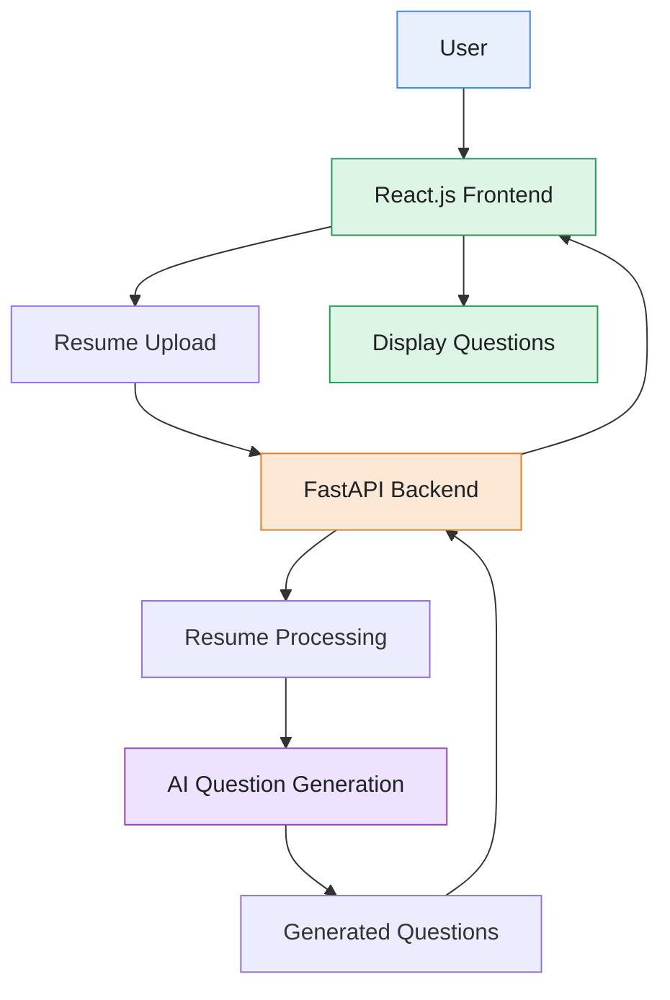

# 🎯 AI-Interview Practice
### AI-Powered Resume-Based Interview Preparation Platform

An intelligent web application designed to help students and job seekers prepare for technical interviews by generating personalized interview questions based on their resume content.

---

## 📌 Project Overview

**AI-Interview Practice** aims to simplify technical interview preparation by analyzing a candidate's resume and generating relevant questions based on their skills, projects, and technical background.

The application combines a React.js frontend with a Python FastAPI backend to provide an interactive and personalized interview preparation experience.

## ✨ Key Features

- 📄 **Resume Upload** — Upload a resume to begin interview preparation.
- 🤖 **AI-Based Question Generation** — Generate relevant interview questions from resume content.
- 🎯 **Personalized Practice** — Focus on questions related to skills and projects.
- 💻 **Interactive Interface** — User-friendly web application for interview preparation.
- 🔧 **Modular Design** — Separate frontend and backend components for maintainability.

## 🏗️ System Architecture



### Architecture Components

| Component | Responsibility |
|---|---|
| React.js Frontend | Handles user interactions, resume uploads, and question display. |
| FastAPI Backend | Receives requests and coordinates application logic. |
| Resume Processing | Extracts or prepares resume content for analysis. |
| AI Integration | Generates interview questions based on the processed resume. |
| Response Handling | Returns generated questions to the frontend. |

**Workflow:** The user uploads a resume through the frontend. The backend processes the resume content and passes the relevant information to the AI component. Generated questions are returned to the frontend and displayed to the user.

*Note: Adjust the architecture to match your actual implementation.*

## 🛠️ Technology Stack

| Technology | Purpose |
|---|---|
| React.js | Frontend user interface |
| JavaScript | Frontend functionality |
| Python | Backend development |
| FastAPI | REST API development |
| AI Integration | Resume-based question generation |
| Git & GitHub | Version control |

## 📂 Project Structure

```text
AI-Interview/
├── backend/
│   ├── main.py
│   ├── requirements.txt
│   └── ...
├── frontend/
│   ├── src/
│   ├── public/
│   ├── package.json
│   └── README.md
├── .gitignore
└── README.md
```

*The structure is illustrative; update filenames to reflect your actual project.*

## ⚙️ Running the Application Locally

### Prerequisites

- Python 3
- Node.js and npm

### 1. Backend Setup

Navigate to the backend directory:

```bash
cd backend
python -m venv venv
```

Activate the environment in Windows PowerShell:

```powershell
.\venv\Scripts\Activate.ps1
```

Install the dependencies:

```bash
pip install -r requirements.txt
```

Create a local `.env` file containing the environment variables required by the application.

Start the server using the appropriate entry point. For example, if `main.py` contains a FastAPI instance named `app`:

```bash
uvicorn main:app --reload
```

### 2. Frontend Setup

Open a separate terminal:

```bash
cd frontend
npm install
npm run dev
```

Open the local development URL displayed in the terminal.

*Ensure that the commands and configuration match your actual project setup.*

## 🔐 Security Practices

- Keep API keys and credentials in environment variables.
- Never upload `.env` files or secrets to GitHub.
- Exclude virtual environments and dependency folders from version control.
- Protect uploaded resumes and other personal information.
- Validate uploaded files and handle errors securely.

## 🎯 Project Objectives

- Make technical interview preparation more accessible.
- Generate questions relevant to a candidate's resume.
- Help candidates revise skills and project knowledge.
- Improve interview readiness through personalized practice.

## 🔮 Future Enhancements

- Interactive mock interviews.
- AI-based answer evaluation and feedback.
- Question difficulty levels and technical categories.
- Interview progress tracking.
- Support for additional interview roles.
  

⭐ If you find this project interesting, consider starring the repository.

*Prepare smarter. Practice confidently. Interview successfully.*
